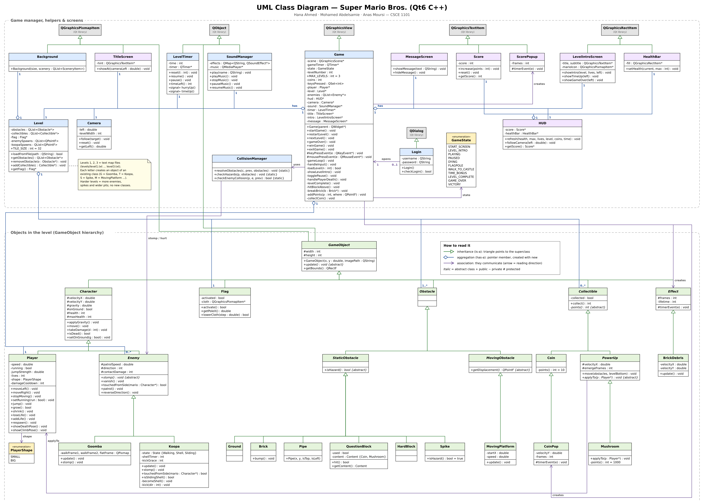

# Super Mario Bros. — World 1-1 in Qt6 C++

A remake of the first level of *Super Mario Bros.* (NES, 1985), written in C++ with the Qt 6 Graphics View framework for **CSCE 1101 – Fundamentals of Computing II**.

**Team:** Hana Ahmed · Mohamed Abdelsamie · Anas Moursi

---

## Features

- **Title screen** with the original logo. Click to start.
- **WORLD 1-1 intro screen** before the level and after losing a life. **TIME UP** and **GAME OVER** screens.
- **Mario:** walk, run, jump. Small and Big Mario (Super Mushroom). Blinks after being hurt. Death animation.
- **Scrolling camera** that follows Mario (one-way, like the original).
- **Level built from a text map** (`levels/level1.txt`): ground, pits, bricks, hard-block stairs, pipes of different heights, spikes, a moving platform, coins, scenery (hills, bushes, clouds, castle).
- **? blocks** that give a coin (it pops out of the block) or a Super Mushroom. Big Mario breaks bricks; small Mario bumps them.
- **Enemies:**
  - **Goomba:** walks, turns around at walls, pipes, spikes and other enemies, gets squashed when stomped.
  - **Koopa Troopa:** stomp it to hide it in its shell, kick the shell, and the shell knocks out other enemies.
  - Enemies only start moving when they come onto the screen.
- **HUD (always on screen):** score, coins, world, TIME countdown, lives and a health bar.
- **Scoring:** floating score pop-ups. The score is never reset between levels, only on game over.
- **End of level:** grab the flagpole (more points the higher you grab it), slide down, walk into the castle, and the leftover TIME turns into points.
- **Lives:** 3 lives. Losing all health restarts the level. Losing all lives shows GAME OVER, and a click restarts from Level 1.
- **Sound:** background music and the original sound effects (jump, coin, stomp, kick, power-up, bump, brick break, flagpole, death, game over, hurry-up…).
- **Pause** with **P** and **run** with **Shift**.

## Controls

| Key | Action |
| --- | --- |
| ← / → or A / D | Move |
| Space / ↑ / W | Jump |
| Shift (hold) | Run |
| P | Pause / continue |
| Mouse click | Start the game · Restart after GAME OVER · Exit after the final message |

## Game rules

| Event | Result |
| --- | --- |
| Stomp a Goomba / Koopa | +100 |
| Kick a Koopa shell | +400 |
| Shell knocks out an enemy | +500 |
| Coin from a ? block | +200 and +1 coin |
| Super Mushroom | +1000, Mario becomes big |
| Break a brick (Big Mario) | +50 |
| Flagpole | +100 to +5000, depending on height |
| Leftover TIME | +50 per unit |
| 100 coins | +1 life |
| Touching an enemy | −20 health (Big Mario shrinks instead) |
| Touching spikes | −25 health |
| Falling in a pit / health reaches 0 / TIME reaches 0 | Lose a life |

## How to build and run

**Requirements:** Qt **6** with the **Qt Multimedia** module, and Qt Creator (any OS: Windows, macOS or Linux).

1. Clone the repository:
   ```bash
   git clone https://github.com/hanaahmed-303/CS-2-Project-Super-Mario.git
   ```
2. Open **`SuperMario/SuperMario.pro`** in Qt Creator.
3. Choose your Qt 6 kit and click **Configure Project**.
4. Press **Run** (▶).

All images, sounds and level maps are compiled into the program through the Qt resource file (`resouces.qrc`) and loaded with `:/…` / `qrc:/…` paths. The project has **no absolute paths** and runs on any machine without copying files around.

If Qt Creator says the multimedia module is missing, install **Qt Multimedia** from the Qt Maintenance Tool for your Qt 6 version.

## Project structure

```
SuperMario/
├── SuperMario.pro        qmake project file
├── resouces.qrc          Qt resource file (images, sounds, levels)
├── main.cpp              creates and shows the Game window
├── game.*                Game: window, game loop, states, levels, score
├── gameobject.*          GameObject: base class of everything in the level
├── character.*           Character: movement, gravity, health
├── player.*              Player (Mario)
├── enemy.* goomba.* koopa.*
├── obstacle.*            Ground, Brick, Pipe, QuestionBlock, HardBlock, Spike, MovingPlatform
├── collectible.* coinpop.* powerup.*   Coin, CoinPop, PowerUp, Mushroom
├── effect.*              Effect, BrickDebris
├── flag.* background.* level.*
├── collisionmanager.* camera.* leveltimer.* soundmanager.*
├── hud.* score.* healthbar.* scorepopup.*
├── titlescreen.* levelintroscreen.* messagescreen.*
├── images/               sprites
├── sounds/               music and sound effects
└── levels/               level maps (text files)
docs/
└── UML.png               UML class diagram
```

## Design (OOP)



- **Inheritance:**
  - `GameObject` → `Character` → `Player` / `Enemy` → `Goomba`, `Koopa`
  - `GameObject` → `Obstacle` → `StaticObstacle` / `MovingObstacle`
  - `GameObject` → `Collectible` → `Coin` / `PowerUp` → `Mushroom`
- **Abstract classes and polymorphism:** `GameObject::update()`, `Enemy::stomp()`, `StaticObstacle::isHazard()`, `PowerUp::applyTo()` and `Collectible::points()` are pure virtual. `Game` keeps one `QList<Enemy*>` and calls `enemy->stomp()`, and the Goomba or Koopa version runs.
- **Aggregation:** `Game` has a `Player`, a `Level`, the enemies, the `HUD`, the `Camera`, the `LevelTimer`, the `SoundManager` and the screens. `Level` has the obstacles, collectibles and the flag.
- **State machine:** `GameState` (`START_SCREEN`, `LEVEL_INTRO`, `PLAYING`, `PAUSED`, `DYING`, `FLAGPOLE`, `WALK_TO_CASTLE`, `TIME_BONUS`, `LEVEL_COMPLETE`, `GAME_OVER`, `VICTORY`).
- **Qt signals and slots:** `LevelTimer` emits `hurryUp()` and `timeUp()`. The game loop runs on a `QTimer` (~60 FPS).

## Level map format

Each level is a text file. Every character is one 32 × 32 tile.

| Symbol | Meaning | Symbol | Meaning |
| --- | --- | --- | --- |
| `.` | Empty | `A` | Mario's start |
| `#` | Ground | `G` | Goomba |
| `B` | Brick | `T` | Koopa Troopa |
| `H` | Hard block (stairs) | `C` | Coin |
| `Q` | ? block (coin) | `F` | Flagpole |
| `U` | ? block (Super Mushroom) | `k` | Castle |
| `P` | Pipe (height = number of rows) | `c` | Cloud (scenery) |
| `S` | Spikes | `m` / `n` | Big / small hill (scenery) |
| `M` | Moving platform | `b` / `u` | Big / small bush (scenery) |

## Milestones

- [x] **Milestone 1:** UML design
- [x] **Milestone 2:** Level 1 fully playable
- [ ] **Final:** Levels 2 and 3 with increasing difficulty

## Credits

*Super Mario Bros.* and all its characters, graphics and sounds belong to **Nintendo**. The original sprites and sound effects are used here only for this university course project (approved by the course TA). This is a non-commercial student project.
